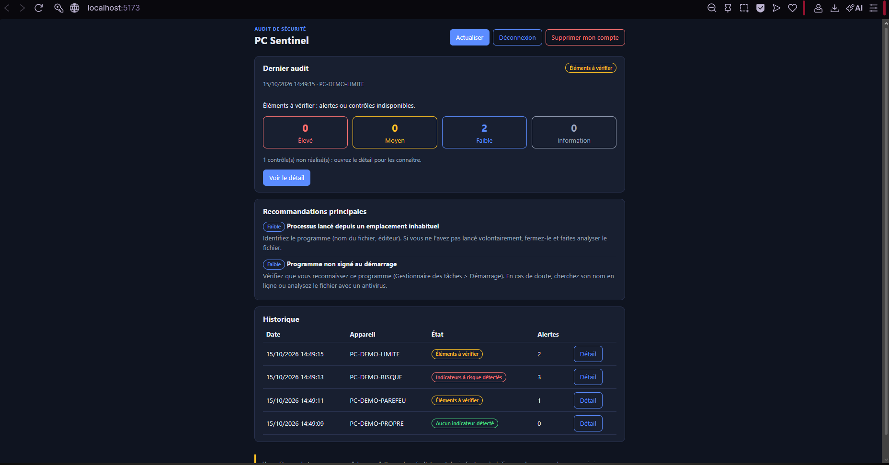

# PC Sentinel


Plateforme d'audit de sécurité d'un PC Windows : un agent local lit l'état du système **en lecture seule**, une API applique des règles explicables, et une interface web présente alertes, recommandations, historique et rapport.

> Un audit sans alerte ne prouve pas l'absence d'attaque. PC Sentinel signale des indicateurs à vérifier ; ce n'est pas un antivirus.



## Ce que fait le projet

- 6 contrôles : pare-feu, antivirus, mises à jour, programmes au démarrage, processus, échecs de connexion.
- 7 règles versionnées avec gravité, explication, recommandation et limites ([catalogue](docs/rules.md)).
- Consentement explicite avant chaque audit, collecte minimale, aucun mot de passe ni fichier personnel.
- Les contrôles impossibles sont signalés comme tels, jamais présentés comme « sains ».
- Rapport HTML exportable ([exemple](docs/exemple-rapport.html)), suppression des audits et du compte.

## Démarrage rapide

```powershell
git clone https://github.com/Habib101-cmd/PC-Sentinel.git
cd PC-Sentinel
copy .env.example .env      # puis remplacer les secrets (voir docs/installation.md)
docker compose up --build
python scripts/seed_demo.py # compte « demo » avec des audits fictifs
```

Interface : http://localhost:5173 · API : https://localhost:8443/docs

## Documentation

[Installation](docs/installation.md) · [Utilisation](docs/utilisation.md) · [Architecture](docs/architecture.md) · [Règles](docs/rules.md) · [Limites connues](docs/limites.md)

## Stack

Python (agent, FastAPI, SQLAlchemy, Alembic) · PostgreSQL · React + Vite · Docker Compose · Caddy · pytest · GitHub Actions
