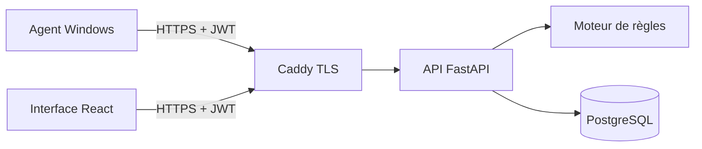

# Architecture

| Composant        | Rôle                                                           | Dossier              |
| ---------------- | -------------------------------------------------------------- | -------------------- |
| Agent            | Collecte en lecture seule (PowerShell), consentement, envoi    | `agent/`             |
| API              | Authentification, validation, stockage, rapports               | `backend/app/`       |
| Moteur de règles | Une règle par fichier, versionnée, avec explication et limites | `backend/app/rules/` |
| Base             | Comptes et audits, migrations Alembic                          | `backend/alembic/`   |
| Interface        | Tableau de bord, détail, suppression                           | `frontend/`          |
| Proxy            | HTTPS local, taille des requêtes, en-têtes                     | `Caddyfile`          |

## Modèle de données

**users** : `id`, `username` (unique), `password_hash` (Argon2).
**audits** : `id`, `audit_id` (UUID public), `user_id` (clé étrangère), `device_name`, `os_name`, `os_version`, `duration_seconds`, `audited_at`, `status`, `summary`, `ruleset_version`, `checks` (JSON, observations reçues), `alerts` (JSON), `unavailable_checks` (JSON).

## Flux d'un audit

1. L'agent affiche les données collectées et demande le consentement.
2. Il exécute chaque contrôle ; un échec devient `unavailable`, jamais un résultat inventé.
3. Il envoie `{device_name, os, duration_seconds, checks[]}` en HTTPS avec le jeton.
4. L'API valide les tailles et les types, puis applique les règles (`evaluate`).
5. `global_status` calcule l'état : à risque (alerte Élevé), à vérifier (alerte ou contrôle manquant), aucun indicateur.
6. L'audit est stocké avec la version du jeu de règles.

## Sécurité

Argon2 pour les mots de passe, JWT de 8 h, filtrage par `user_id` sur chaque route d'audit, limiteurs de tentatives, journal sans secret, HTTPS, validation stricte, rapport HTML échappé et sous politique CSP restrictive.

## Ajouter une règle

1. Créer `backend/app/rules/ma_regle.py` avec un `register(Rule(...))`.
2. L'importer dans `rules/__init__.py` ; si elle utilise un nouveau contrôle, l'ajouter à `EXPECTED_CHECKS` et à l'agent (et à `COLLECTED_DATA`).
3. Incrémenter `RULESET_VERSION`, écrire les tests, regénérer `docs/rules.md`.
